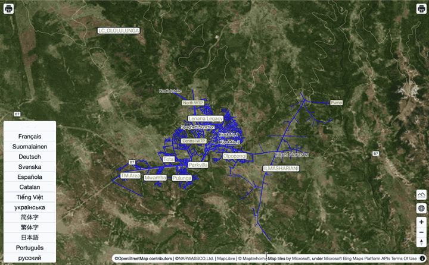

# maplibre-gl-export

This monorepo manages the source code and demo page for `@watergis/maplibre-gl-export` and `@watergis/mapbox-gl-export`.

## Repositories

| repository | version | description | changelog |
|---|---|---|---|
|[@watergis/maplibre-gl-export](./packages/maplibre-gl-export/)|  | To manage maplibre export plugin source code|[CHANGELOG](./packages/maplibre-gl-export/CHANGELOG.md)|
|[@watergis/mapbox-gl-export](./packages/mapbox-gl-export/)|  | To manage mapbox export plugin source code|[CHANGELOG](./packages/mapbox-gl-export/CHANGELOG.md)|
|[@watergis/export-ui](./packages/export-ui/)| - (private) | Internal Svelte UI of the export dialog, bundled into maplibre-gl-export and mapbox-gl-export |[CHANGELOG](./packages/export-ui/CHANGELOG.md)|
|[@watergis/maplibre2svg](./packages/maplibre2svg/)| - (private) | Convert a rendered MapLibre GL JS map into a vector SVG |[CHANGELOG](./packages/maplibre2svg/CHANGELOG.md)|
|[Demo & Documentation](./sites/demo/)| - | Demo website code for maplibre/mapbox export plugins |-|

## Contribution

See [CONTRIBUTING](./CONTRIBUTING.md)

## License

[MIT License](LICENSE)
